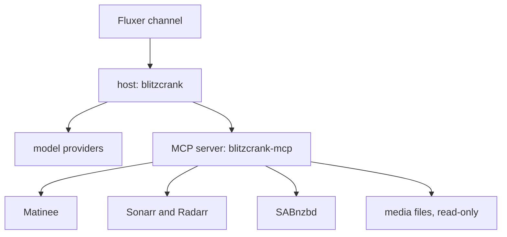

# blitzcrank

blitzcrank is a chat agent for a private media homelab. Someone posts
`Crystal Lake ist ab Episode 6 falsch` in a Fluxer channel. blitzcrank opens a
thread, looks through Matinee, Sonarr, Radarr, and SABnzbd, fixes what the
evidence supports, and answers in the thread.

Matinee is the media server people watch on and request titles from. Sonarr,
Radarr, and SABnzbd sit behind it and fetch the files.

## How it works

blitzcrank runs as two processes that share no code.

The host lives in `packages/host` and installs the `blitzcrank` command. It
takes Fluxer messages, runs the agent on
[Pi Durable](https://www.npmjs.com/package/@earendil-works/pi-durable), and
posts the agent's final message in the thread. It holds the model credentials
and the Fluxer bot token. It has no service API keys and no media mounts.

The MCP server lives in `packages/mcp` and installs `blitzcrank-mcp`. It holds
the service API keys and the media mounts. Each read or write the agent can
make is one tool on this server, defined in the
[service tables](packages/mcp/src/services).

A run starts with a few host tools and loads server tools with `tool_search`
as it needs them. Before any write that can remove or change media, a second
model reviews it and can hold it. A thread never has two runs at once, and
nothing runs on a timer.

blitzcrank uses Pi Durable as an SDK dependency. It does not package or launch
the Pi app.

## Setting up

Work through these in order.

1. [Deploy on NixOS](docs/deploy.md) with both services, on one machine or
   two.
2. [Pick the models](docs/models.md) and sign in to their providers.
3. [Make a Matinee token](docs/matinee.md) with exactly the permissions the
   agent uses.
4. [Create the Fluxer bot](docs/fluxer.md) and choose who it answers.
5. Send a test message, or [run one from a terminal](docs/run.md), and
   [read the logs](docs/operations.md).

## Reference

| Page                                         | What's in it                                          |
| -------------------------------------------- | ----------------------------------------------------- |
| [Write review](docs/write-review.md)         | Which writes the gate model checks and what it holds  |
| [Tools](docs/tools.md)                       | Host tools, media inspection, and optional web search |
| [Logs and journals](docs/operations.md)      | Log records, SQLite journals, backups, health checks  |
| [Develop locally](docs/development.md)       | devenv, running both processes, checks                |
| [MCP server](packages/mcp/README.md)         | Server settings, Matinee permissions, write semantics |
| [`.env.example`](packages/host/.env.example) | Every host and Fluxer setting                         |
| [AGENTS.md](AGENTS.md)                       | Invariants and contribution rules                     |
| [Skills](packages/host/skills)               | What the agent knows about each service               |

## License

[MIT](LICENSE)
